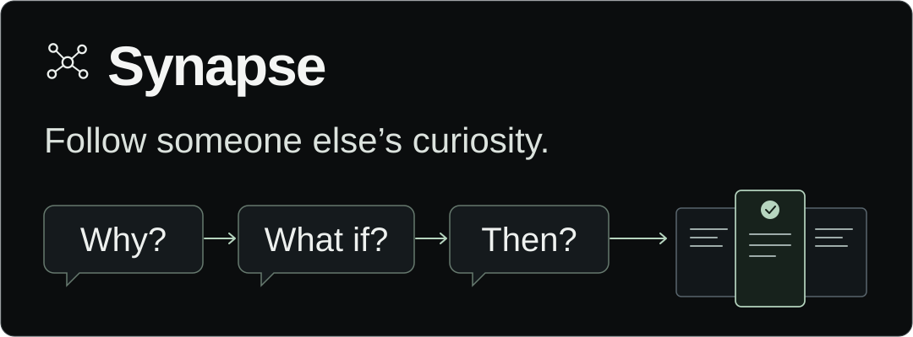
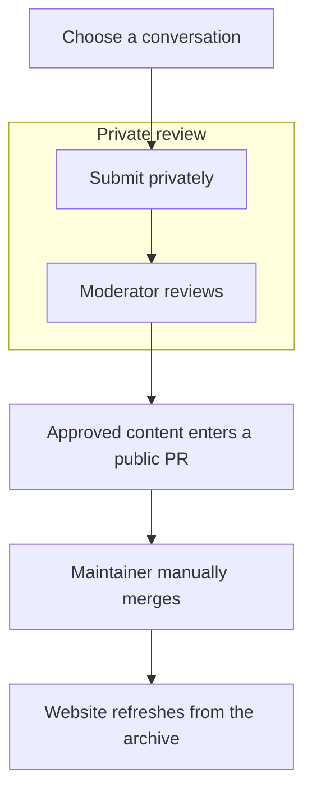

# Synapse

**Follow someone else’s curiosity.**

An interesting conversation rarely ends with the first answer. Synapse is a community collection of selected AI conversations people voluntarily share, including the follow-ups, doubts, and unexpected turns. Explore an exchange from an AI tool someone already uses, discover a question you had not considered, or share one of your own.

**[Explore Synapse](https://synapse.ctrlchaos.io/) · [Share a conversation](https://synapse.ctrlchaos.io/synapse/contribute) · [Contribution guide](CONTRIBUTING.md) · [Archive format](docs/records.md)**

Synapse is a noncommercial CTRL+CHAOS community project maintained by Abe. This repository, **synapse-archive**, holds published conversation records and their public metadata. The website application is maintained separately in a private repository. Unpublished submissions and moderation stay private and do not belong here.

## On this page

- [Why explore?](#why-explore)
- [A small question trail](#a-small-question-trail)
- [Explore the collection](#explore-the-collection)
- [How Synapse works](#how-synapse-works)
- [Share a conversation](#share-a-conversation)
- [What makes a useful contribution?](#what-makes-a-useful-contribution)
- [Privacy and permission](#privacy-and-permission)
- [Corrections, withdrawal, and removal](#corrections-withdrawal-and-removal)
- [Authenticity and limitations](#authenticity-and-limitations)
- [Inside this repository](#inside-this-repository)
- [Data format and taxonomy](#data-format-and-taxonomy)
- [Read, download, and reuse](#read-download-and-reuse)
- [Licensing](#licensing)
- [Help the project](#help-the-project)
- [Project status and about](#project-status-and-about)

## Why explore?

Someone else’s question could take you somewhere you never thought to explore.

- Discover a subject you would not have searched for.
- Follow questions beyond the first answer.
- See a different way to approach a problem.
- Notice an assumption being challenged.
- Find an unresolved question worth exploring yourself.

Everyday curiosity belongs alongside mathematics, engineering, science, history, arts, philosophy, and other interests. A useful exchange does not need difficult vocabulary, academic credentials, or a long transcript. These are examples of inquiry, not measurements of intelligence or portraits of an entire person.

## A small question trail

**Illustrative example, not a real contributor conversation.** These lines come from the already-published, scripted [cache-size example](explorations/8a74bc63-8571-4cc3-9bee-31fb0404c9cb.json):

> **Starting question:** If a cache makes lookups faster, why not let it keep everything?
>
> **Follow-up:** So reaching the limit should remove something, rather than refuse every new item?
>
> **Left open:** Which eviction policy fits a workload with frequently repeated lookups?

The last line is the record’s unresolved question, not an additional transcript message. [Read the complete example, including its scripted replies](https://synapse.ctrlchaos.io/synapse/explorations/synthetic-example-why-a-cache-needs-a-size-limit). No actual AI provider or real contributor is represented by this illustration. The header artwork is also an illustration, not another archive record.

## Explore the collection

[Open the conversation browser](https://synapse.ctrlchaos.io/synapse/explore). Each reader preserves human messages, AI replies, and follow-ups in order, with public context and disclosures. Individual conversation pages offer a public JSON download.

| To find your next conversation | Available now |
| --- | --- |
| Look for a phrase or question | Search titles, context, human messages, replies, reflections, and tags |
| Narrow a subject or format | Filter by subject, language, provider, model, and reading time |
| Look more closely | More filters cover reasoning approach, purpose, human-message count, reported verification, community or illustrative status, and publication date |
| Change your starting point | Sort by recent publication, title, reading time, or human-message count |

Illustrative examples are labelled, and the browser distinguishes them from community conversations. The website can also show built-in examples that are not archive files. Do not infer the number of genuine contributions from the number of website cards.

## How Synapse works



Submitting does **not** immediately publish anything. A moderator checks the selected material, permission, privacy, and proposed public version first. A shared link without messages waits for manual import and review.

A pull request, or PR, proposes a change to this public collection. **Public branches and PRs are already public before merge. Only content approved for public release may enter them.** Private originals, permission records, and moderator notes must stay out of the branch, diff, comments, and attachments.

A maintainer manually merges approved changes. Merged records on the archive’s default branch are the source for the website’s validated public snapshot. A maintainer then refreshes that snapshot; this is a separate step, not an instant update or a per-submission website deployment. [Publication and refresh details](docs/architecture.md).

## Share a conversation

Start at **[Share your conversation](https://synapse.ctrlchaos.io/synapse/contribute)**. Both options are visible there:

| Option | What happens |
| --- | --- |
| Paste selected conversation text | Separate messages, check speakers and wording, review the proposed public record, and confirm permission before submitting privately |
| Paste a supported public/shared-chat link | Review everything the link exposes, then send the URL into the private queue without supplying a transcript. A moderator must manually import and review the actual messages |

Accepted shared-link hosts are **chatgpt.com**, **claude.ai**, and **gemini.google.com**, using their supported `/share/` formats. Query strings, fragments, credentials, and explicit ports are not accepted. [Exact formats and preparation steps](CONTRIBUTING.md#supported-shared-links).

Automatic link importing is unavailable. Links may expire, be revoked, or require sign-in; saving a URL does not verify its contents. Paste selected text when a link is unsuitable. No GitHub account, AI API key, or AI API call is required for basic submissions. Synapse does not offer email submission.

The text option includes **Optional help: prepare a conversation with AI**, with copyable prompts and optional JSON import. A prompt can use only the messages available in that chat or excerpts you supply, not your entire account history. Inspect every message yourself and exclude the preparation request and its output from the original exchange.

## What makes a useful contribution?

A short, thoughtful exchange can be enough. Perfect English and technical expertise are not required. Look for a starting question, follow-ups that develop it, challenges or corrections, enough AI replies to make the exchange understandable, or something left unresolved. An optional reflection can explain why the conversation mattered to you.

Preserve original wording and speaker order. Disclose omissions, redactions, and edits. Do not rewrite someone to sound more knowledgeable, fabricate missing exchanges, or infer beliefs from a selected excerpt. [Preparation checklist](CONTRIBUTING.md#prepare-the-exchange).

## Privacy and permission

Before sharing, check for personal information, contact details, credentials, confidential employer or client material, information about other people, and third-party text you lack permission to share. Review everything exposed by a shared link, including messages beyond the excerpt you intended to contribute. No automated redaction guarantees privacy.

Text contributions support a public display name, including a nickname or **Anonymous**. This is attribution, not a guarantee that the transcript cannot identify someone. No contact email is collected by the Synapse submission form. The original and proposed public text, permission confirmation, and review history are held privately; you confirm permission after the contribution terms and commercial-reuse disclosure.

This public repository must never contain unreviewed originals, private consent records, moderator notes, authentication details, credentials, or private service configuration. **Do not submit raw conversations through GitHub issues or PRs.** Use the website for private review.

See the [live guidelines and contribution terms](https://synapse.ctrlchaos.io/synapse/guidelines#terms) and [contribution guide](CONTRIBUTING.md#privacy-and-consent).

## Corrections, withdrawal, and removal

Use [Report or request removal](https://synapse.ctrlchaos.io/synapse/report). Public issues can identify an already-public record and a safe description of a problem. For unpublished submissions, privacy concerns, rights questions, or sensitive evidence, use the [private project contact route](https://ctrlchaos.io/contact), with the record ID or submission reference and only necessary details.

There is no self-service withdrawal control. Ask the maintainer privately about withdrawing an unpublished submission or deleting private records. Current MVP policy retains private originals, rejected submissions, consent, and review history without automatic deletion; Abe reviews requests.

Published corrections or removal require a reviewed archive change, manual merge, and successful website refresh. Git history, PRs, forks, clones, downloads, and third-party copies may remain. Removal cannot guarantee erasure from the internet or revoke permissions already granted under CC BY 4.0. No removal deadline is promised. [Reporting and removal details](docs/reporting-and-removal.md).

## Authenticity and limitations

| Public disclosure | What it means |
| --- | --- |
| `provenance_type` and `is_illustrative` | Distinguish contributor-selected material from invented illustrations; the two fields must agree |
| `verification_status` | Contributor-reported checking, not independent fact-checking or an authenticity certificate |
| `editing_disclosure` and annotations | Explain omissions, redactions, edits, or contributor notes; they do not reconstruct missing messages |

AI replies can contain errors. Publication is not endorsement, certification, or a guarantee of authorship or accuracy. Visible messages and optional reflections do not establish a person’s complete views, intelligence, or private reasoning. The collection is voluntary and curated, with selection bias; it is not representative of the general population.

## Inside this repository

```text
synapse-archive/
├── README.md
├── CONTRIBUTING.md
├── RIGHTS.md
├── assets/
│   └── synapse-banner.svg
├── docs/
│   ├── architecture.md
│   ├── records.md
│   ├── taxonomy.md
│   └── reporting-and-removal.md
└── explorations/
    └── <record-id>.json
```

`explorations/` holds canonical published records, one JSON file per stable ID. The website source and private submission queue are elsewhere. Website snapshots and search indexes are rebuildable views of this collection, not competing sources of truth. No workflow, deployment configuration, package, or analysis tool is introduced by this documentation.

## Data format and taxonomy

Schema version **1.0** preserves selected visible exchanges and public metadata:

| Area | Actual fields |
| --- | --- |
| Identity | `schema_version`, `id`, `slug`, `title` |
| Discovery | `subject`, `tags`, `reasoning_approaches`, `purpose`, `language` |
| Conversation | Ordered `messages` with `id`, `role`, and original `text`; `context`, `annotations`, `reflection`, `unresolved_questions` |
| Attribution and source | `contributor_display_name`, `ai_provider`, `ai_model`, `source_url` |
| Dates and disclosure | `conversation_date`, `published_at`, `verification_status`, `editing_disclosure`, `provenance_type`, `is_illustrative` |

See [the full field reference and complete JSON example](docs/records.md), [current taxonomy](docs/taxonomy.md), and [canonical generated JSON Schema](https://synapse.ctrlchaos.io/synapse/schema). This repository documents the application’s authoritative schema rather than maintaining a second hand-written definition. Machine validation and editorial privacy/permission review are different requirements.

## Read, download, and reuse

Read [JSON files on GitHub](explorations/), browse [Synapse](https://synapse.ctrlchaos.io/), or use a conversation’s **Download public JSON** link. For a local copy:

```sh
git clone https://github.com/itsctrlchaos/synapse-archive.git
cd synapse-archive
git ls-files 'explorations/*.json'
```

You can also use GitHub’s **Code → Download ZIP**. Records are ordinary UTF-8 JSON. This repository does not provide a package, analysis toolkit, or promised public API service.

A practical attribution for the approved synthetic example is:

> “Synthetic example: why a cache needs a size limit,” Synapse synthetic example, [Synapse public archive](https://github.com/itsctrlchaos/synapse-archive/blob/main/explorations/8a74bc63-8571-4cc3-9bee-31fb0404c9cb.json). [CC BY 4.0](https://creativecommons.org/licenses/by/4.0/), for rights the contributor can grant. Reproduced without changes.

For a real reuse, replace the title, supplied public display name, and record link; state your actual changes and preserve required notices. If the display name is Anonymous, credit **Anonymous** without trying to identify the contributor. Read the record’s editing and verification disclosures. Keep illustrative material identifiable and distinguish AI answers from established facts. These interpretation suggestions do not add restrictions to the license.

## Licensing

Synapse’s noncommercial purpose does not prohibit commercial reuse of licensed contributions. Under approved terms **mvp-v1**, CC BY 4.0 applies **only to rights contributors own or are authorized to license in approved public content**. The license permits commercial reuse under its conditions, including appropriate attribution, a license link, and indication of changes as applicable. Those permissions are irrevocable while conditions are followed.

Contributors cannot license rights they do not own or control. Separate rights in AI output and third-party material are not automatically granted. See [rights and licensing scope](RIGHTS.md), the [CC BY 4.0 license](https://creativecommons.org/licenses/by/4.0/), and the [actual contribution terms](https://synapse.ctrlchaos.io/synapse/guidelines#terms).

The conversation policy is **not a blanket license for documentation, artwork, the logo, or private website code**. No separate reuse license for those materials is assigned here; see [RIGHTS.md](RIGHTS.md#documentation-artwork-and-code).

## Help the project

- Share a suitable exchange through the [website](https://synapse.ctrlchaos.io/synapse/contribute).
- Report a broken link or an inaccurate **public** record, using only information safe to publish.
- Improve documentation or suggest taxonomy changes through public issues and documentation PRs.
- Help someone discover a conversation they might enjoy.

Do not expose unpublished conversations while helping. Raw submissions and sensitive concerns belong in the private website/contact flow. Proposed category changes need compatibility review rather than silent renaming of published values.

## Project status and about

**The MVP is live.** It supports private text and link intake, moderator review, approval before a public PR, manual maintainer merge, and public browsing/search after archive refresh. Shared-link import and refresh remain manual steps. There is no automatic fact-checking, authenticity guarantee, or instant-publication promise.

Synapse is a **CTRL+CHAOS community project maintained by Abe**. Visit [CTRL+CHAOS](https://ctrlchaos.io/), [read the project guidelines](https://synapse.ctrlchaos.io/synapse/guidelines), or [contact the project privately](https://ctrlchaos.io/contact).
